<div align="center">

  <!-- Animated Hero Banner with Live Neon Laser Light Border & Holographic Card -->
  <a href="https://atahar-shihab.github.io/Payooo-Mobile-Bank/">
    
  </a>

  <br/><br/>

  <!-- Live Status & Technology Badges -->
  <p align="center">
    <a href="https://atahar-shihab.github.io/Payooo-Mobile-Bank/">
      
    </a>
    <a href="https://github.com/Atahar-Shihab/Payooo-Mobile-Bank/actions/workflows/deploy-pages.yml">
      
    </a>
    
    
    
  </p>

  <!-- Interactive Quick Navigation Pills -->
  <p align="center">
    <a href="#-quick-sandbox-access"><code>🔑 Sandbox Login</code></a> •
    <a href="#-core-fintech-matrix"><code>💳 Feature Matrix</code></a> •
    <a href="#-interactive-terminal-telemetry"><code>💻 Live Terminal</code></a> •
    <a href="#-keyboard-shortcuts"><code>⚡ Omnibox Shortcuts</code></a> •
    <a href="#-architecture--persistence"><code>📁 Architecture</code></a> •
    <a href="#-local-setup"><code>🚀 Run Locally</code></a>
  </p>

  <br/>

  <!-- 4 Glowing Glassmorphic Metric Stat Cards with Glint Animations -->
  <a href="https://atahar-shihab.github.io/Payooo-Mobile-Bank/home.html">
    
  </a>

</div>

<br/>

---

## 💡 Overview

**Payoo Mobile Bank** is a portfolio-grade, institutional frontend digital wallet and fintech super-app designed for Bangladesh’s dynamic mobile financial ecosystem. Inspired by Stripe, Revolut, and bKash, Payoo delivers an ultra-responsive, zero-latency transaction sandbox running entirely client-side.

Every monetary interaction—from peer-to-peer transfers and multi-operator recharges to real-time remittance incentives and QR payments—is accompanied by reactive DOM updates, dynamic 7-day flow analytics, downloadable official receipt slips, and synthesized Web Audio feedback.

> [!NOTE]
> **Educational Sandbox**: This is a production-grade frontend demonstration application. All transactions, cryptographic simulations, and bank balance states persist client-side via browser `localStorage`. No actual monetary transactions or external banking rails are contacted.

---

<div id="-quick-sandbox-access"></div>

## 🔑 Quick Sandbox Access

Try the complete wallet immediately without manual registration using the pre-configured credentials:

<div align="center">

| Parameter | Sandbox Value | One-Click Action |
| :--- | :--- | :--- |
| **Mobile Number** | `00000000000` *(or any 11-digit `01XXXXXXXXX`)* | Click **Auto-fill** on Sign-in Page |
| **Security PIN** | `0000` | Pre-loaded in demo sandbox |
| **Welcome Bonus Code** | `PAYOO100` | Claims **৳100.00** bonus on Rewards page |
| **Starter Balance** | `৳4,500.00` | Automatically initialized in LocalStorage |

</div>

<details open>
<summary><strong>🎯 How to Launch the Demo</strong> (Click to collapse)</summary>

1. Navigate to the live demo: **[atahar-shihab.github.io/Payooo-Mobile-Bank](https://atahar-shihab.github.io/Payooo-Mobile-Bank/)**
2. In the credentials card, click the **Auto-fill** chip to instantly fill in `00000000000` and `0000`.
3. Click **Sign In to Payoo** to launch the Super-App Dashboard with 3D card tilt and real-time ledger.
4. Press `Ctrl + K` (or `Cmd + K` on macOS) anywhere inside the dashboard to search actions, switch themes, or trigger services via the Omnibox.

</details>

---

<div id="-core-fintech-matrix"></div>

## 💳 Core Fintech Matrix

Payoo integrates 8 essential mobile financial modules into a unified dashboard:

```
┌────────────────────────────────────────────────────────────────────────┐
│                        PAYOO MFS PLATFORM CORE                         │
├─────────────────┬─────────────────┬──────────────────┬─────────────────┤
│   ADD MONEY     │   SEND MONEY    │     CASH OUT     │ MOBILE RECHARGE │
│ 5 Banks & Cards │  Zero-Fee P2P   │ 1.49% Real-Time  │ 5 BD Operators  │
│  Instant Top-up │ Instant Balance │  Fee Breakdown   │ Pre & Postpaid  │
├─────────────────┼─────────────────┼──────────────────┼─────────────────┤
│    PAY BILL     │  REQUEST MONEY  │    SPLIT BILL    │  SCAN & PAY QR  │
│ Utility & ISPs  │  Peer Invoicing │ Group Expenses & │ Camera Laser    │
│ Ref ID Tracking │ Notification Hub│  Tip Calculator  │ Merchant Detect │
└─────────────────┴─────────────────┴──────────────────┴─────────────────┘
```

<details>
<summary><strong>📊 Detailed Service Directory & Fee Structure</strong> (Click to expand)</summary>

<br/>

| Service | Supported Providers / Channels | Transaction Fee | Limit Per Tx | Real-Time Validations |
| :--- | :--- | :--- | :--- | :--- |
| **Add Money** | City Bank, DBBL/Rocket, IBBL, BRAC Bank, Visa, Mastercard | **৳0.00** (Free) | ৳100 – ৳50,000 | 8–18 digit account checks, 4-digit PIN |
| **Send Money** | Any valid 11-digit Bangladeshi mobile (`013..019`) | **৳0.00** (Free P2P) | ৳10 – ৳25,000 | Recipient validation, non-empty note, balance check |
| **Cash Out** | Certified Payoo Agent points nationwide | **1.49%** (Auto-calc) | ৳100 – ৳25,000 | Transparent dynamic fee preview slip before confirm |
| **Mobile Recharge**| Grameenphone, Robi, Banglalink, Airtel, Teletalk | **৳0.00** (Free) | ৳20 – ৳1,000 | Prepaid / Postpaid switch, quick amount chips |
| **Pay Bill** | DESCO, DPDC, Dhaka WASA, Titas Gas, Carnival, Link3 | **৳0.00** (Free) | ৳50 – ৳50,000 | Customer meter/subscriber account verification |
| **Request Money**| Any registered Payoo contact / phone number | **৳0.00** (Free) | ৳10 – ৳10,000 | Dispatches in-app notification with payment link |
| **Split Bill** | Group dinners, flat rent, shared trips | **৳0.00** (Free) | Up to 12 persons | Tip selector (0%, 5%, 10%, 15%), per-person share |
| **Scan to Pay** | Aarong, Shwapno, Unimart, North End, Yellow | **৳0.00** (Free) | ৳10 – ৳50,000 | Laser viewfinder simulation, merchant auto-fill |

</details>

<details>
<summary><strong>🌍 Global Remittance Engine (Bangladesh Bank 2.5% Bonus)</strong> (Click to expand)</summary>

<br/>

Payoo implements the legal **2.5% Bangladesh Government Cash Incentive** for incoming foreign wage remittances:
- **Supported Corridors**: USD ($), GBP (£), EUR (€), SAR (﷼), AED (د.إ), MYR (RM).
- **Auto-Computation**: Real-time currency conversion + 2.5% government subsidy credited immediately.
- **Simulate Inward Remittance**: 1-click test button crediting converted funds directly to the user's available balance with an official foreign exchange receipt.

</details>

---

<div id="-interactive-terminal-telemetry"></div>

## 💻 Live Terminal Telemetry

<div align="center">
  
</div>

---

<div id="-keyboard-shortcuts"></div>

## ⚡ Omnibox Command Palette & Shortcuts

Press `Ctrl + K` (Windows/Linux) or `Cmd + K` (macOS) anywhere in the application to access the Omnibox. Type fuzzy search terms to jump anywhere without touching the mouse:

```
> send         -> Open Send Money Modal
> theme        -> Toggle Dark / Light Cyber Slate Mode
> qr           -> Show My Personal QR Code & Image Export
> remit        -> Open Global Remittance Calculator
> statement    -> Export Complete Transaction History to CSV
> pin          -> Change 4-digit Security Authorization PIN
```

<div align="center">

| Shortcut | Scope | Action |
| :---: | :---: | :--- |
| <kbd>Ctrl</kbd> + <kbd>K</kbd> / <kbd>Cmd</kbd> + <kbd>K</kbd> | Global | Open / Focus Omnibox Command Palette |
| <kbd>Alt</kbd> + <kbd>T</kbd> | Global | Toggle Dark Mode / Light Mode instantaneously |
| <kbd>Esc</kbd> | Global | Dismiss modal dialogs, drawers, and command palette |
| <kbd>↑</kbd> / <kbd>↓</kbd> + <kbd>Enter</kbd> | Omnibox | Navigate search results and execute selected action |

</div>

---

<div id="-architecture--persistence"></div>

## 📁 Architecture & Local Persistence

Payoo is built with a zero-compilation, hyper-lightweight frontend stack prioritizing instant startup, 60 FPS animations, and offline resilience:

```text
Payooo-Mobile-Bank/
├── .github/workflows/
│   └── deploy-pages.yml          # Automated CI/CD GitHub Pages deployment
├── assets/
│   ├── css/
│   │   └── app.css               # Design system tokens, Cyber Slate mode, print styling
│   ├── readme-hero.svg           # Animated running-laser banner with 3D card
│   ├── readme-stats.svg          # 4 Glowing glassmorphism live metric cards
│   ├── readme-terminal.svg       # Developer simulated telemetry CLI window
│   ├── logo.png                  # Payoo brand insignia
│   └── opt-1.png..opt-6.png      # High-res classic service glyphs
├── script/
│   ├── app.js                    # Reactive state engine, QR generator, split bill, audio synth
│   └── landing-3d.js             # Three.js WebGL holographic card with realistic lighting
├── index.html                    # Institutional landing page with 3D card & sign-in portal
├── home.html                     # Full-featured fintech super-app dashboard
├── manifest.json                 # PWA Web App Manifest (standalone installable)
├── sw.js                         # Service Worker with intelligent offline asset caching
└── readme.md                     # Interactive documentation & project handbook
```

<details>
<summary><strong>💾 LocalStorage Schema & State Machine</strong> (Click to expand)</summary>

<br/>

The entire application state is stored under the `payoo-wallet-v2` key in browser `localStorage`:

```json
{
  "balance": 4500.00,
  "pin": "0000",
  "phone": "00000000000",
  "name": "Shihab Atahar",
  "theme": "dark",
  "savingsGoal": {
    "title": "Dream getaway",
    "target": 60000,
    "saved": 18500
  },
  "transactions": [
    {
      "id": "TX-1729759812",
      "type": "send",
      "title": "Sent to 01711000000",
      "counterparty": "01711000000",
      "amount": -500.00,
      "fee": 0.00,
      "date": "2026-10-24T10:15:00.000Z",
      "category": "Transfers",
      "balanceAfter": 4000.00
    }
  ]
}
```

- **JSON Data Backup & Restore**: Export your complete wallet history via **Account Profile → Export JSON** or import an existing backup file.
- **Factory Reset**: Click **Reset Demo Data** to restore starter balances and fresh transactions at any time.

</details>

---

<div id="-local-setup"></div>

## 🚀 Run Locally

No `npm install`, Node modules, or webpack builds are needed. Payoo runs natively in any modern browser:

### Option 1: Live in Browser
Open `index.html` directly in Google Chrome, Microsoft Edge, Mozilla Firefox, or Safari.

### Option 2: Local Static Server
```bash
# Using Node.js npx serve
npx serve .

# Or using Python 3
python -m http.server 3000

# Or using PHP built-in server
php -S localhost:3000
```

Once running, navigate to `http://localhost:3000` in your browser.

---

## 🛡️ Security, Privacy & Integrity

- **Zero Third-Party Telemetry**: No trackers, ads, or cookies. All interactions stay in your local browser sandbox.
- **DOM Sanitization**: User inputs (notes, names, reference numbers) are escaped to prevent cross-site scripting (XSS).
- **Deterministic Form Validation**: Phone numbers must match the Bangladeshi 11-digit numbering plan (`01XXXXXXXXX`), and amounts are verified against minimum/maximum bounds before ledger mutation.
- **Printable Legal Receipts**: Each transaction generates an official receipt slip formatted via `@media print` for physical paper printing or clean PDF archiving without UI clutter.

---

## 👨‍💻 Author & Acknowledgements

Created with ❤️ by **[Shihab Atahar](https://github.com/Atahar-Shihab)**.

- **Figma Design Reference**: [payoo-MFS.fig](./payoo-MFS.fig)
- **Live Demo**: [atahar-shihab.github.io/Payooo-Mobile-Bank](https://atahar-shihab.github.io/Payooo-Mobile-Bank/)
- **Repository**: [github.com/Atahar-Shihab/Payooo-Mobile-Bank](https://github.com/Atahar-Shihab/Payooo-Mobile-Bank)

*Distributed under the MIT License. Contributions and feedback are welcome!*
